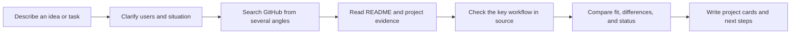

<div align="center">


# EW-SKILLS

[中文](README.zh-CN.md)

### Give your agent the playbook experts never write down

<em>EW-Skills captures the questions, decisions, tools, evidence checks, and recovery paths behind real work—so developers and AI builders can reuse how the work gets done, not just the final answer.</em>

<p>
  <a href="https://github.com/Ethan-Wang-dev/EW-Skills/stargazers"></a>
  <a href="https://github.com/Ethan-Wang-dev/EW-Skills/network/members"></a>
  <a href="https://github.com/Ethan-Wang-dev/EW-Skills/blob/main/LICENSE"></a>
  <a href="https://github.com/Ethan-Wang-dev/EW-Skills"></a>
</p>

<p><strong>Built with the tools and technologies:</strong></p>

<p>
  
  
  
  
</p>

[Get started](#get-started) · [EW-Repo Scout](ew-repo-scout/) · [Contribute](CONTRIBUTING.md)

</div>

---

## What is this?

EW-Skills is a collection of AI Agent Skills that keeps growing. Each Skill turns a difficult task into a clear workflow, useful tools, and a result you can check, so your agent can help move the work forward with you.

The repository contains **21 skills**: EW-Repo Scout, bidirectional Codex ↔ Grok Bot collaboration, and the 18-module EW Overseas Product Discovery family.

## Choose a skill

| Your task | Entry point |
| --- | --- |
| Find related open-source projects or existing skills and check implementation evidence | [ew-repo-scout](ew-repo-scout/SKILL.md) |
| Analyze an overseas-product opportunity, design a test, or review results | [ew-overseas-product-discovery](ew-overseas-product-discovery/SKILL.md) |
| Ask Grok Bot to research sources for Codex | [grok-bot-collab](grok-bot-collab/SKILL.md) |
| Delegate coding, document, and data tasks from Grok Bot to Codex | [codex-offload](codex-offload/SKILL.md) |

Start overseas-product research with the orchestration skill; it selects supporting modules for the current evidence gap.


## EW Demand Evidence

Use it for overseas-product discovery. It reads the user's own knowledge base first, labels direct experience, external observations, interpretations, and hypotheses, then selects small batches of external sources based on missing proof such as frequency, payment, distribution, geography, or delivery risk. It does not treat search volume, likes, or an AI summary as validation.

## EW Overseas Product Discovery

Use the total Skill when you want one guided workflow rather than a collection of separate tools. It exposes three user-facing jobs:

- **Analyze an opportunity** — define the user/job, read your own notes first, collect only the evidence needed for the current gap, and produce an opportunity card.
- **Design a validation** — choose interviews, concierge delivery, a marketplace offer, pre-sale page, prototype, community test, capped paid traffic, B2B pilot, or retention follow-up based on the largest uncertainty.
- **Review a result** — classify qualified events, payments, repeat use, referrals, cost, and limitations, then decide whether to continue, adjust, stop, or run another test.

The source router supports bounded automatic batches through a source registry, using public HTTP/API first and opt-in public browser sessions where needed. It also supports user-authorized sessions and exports. It never requires Firecrawl, bypasses login/CAPTCHA/paywalls/rate limits, or uses browser automation outside the site's terms; the HTTP adapter enforces `robots.txt`. Validation assets are generated locally; publishing, payment, advertising, and mass outreach always require explicit authorization.

The family is intentionally modular:

`ew-demand-intake` · `ew-demand-kb` · `ew-demand-source-router` · `ew-demand-evidence` · `ew-demand-keyword` · `ew-demand-community` · `ew-demand-marketplace` · `ew-demand-reviews` · `ew-demand-competitor` · `ew-demand-trend` · `ew-demand-geo` · `ew-demand-opportunity` · `ew-demand-value` · `ew-demand-score` · `ew-demand-validation` · `ew-validation-assets` · `ew-demand-validation-review` · `ew-overseas-product-discovery`

The shared handoff is documented in [`data-contracts.md`](ew-overseas-product-discovery/references/data-contracts.md). To run a bounded source batch, use `ew-demand-source-router/scripts/run_sources.py`; to build a local page or service asset, use `ew-validation-assets/scripts/build_experiment.py`; to check pre-registered thresholds, use `ew-demand-validation-review/scripts/review_experiment.py`.

Example batch input:

```bash
python3 ew-demand-source-router/scripts/run_sources.py \
  --input research-run.json \
  --output-dir ./research-runs/feedback \
  --max-requests 5
```

Add `--allow-browser` only for public dynamic pages. Each run writes `research-run.json`, `evidence.jsonl`, `analysis.json`, `summary.md`, and per-source adapter records.

For important sources that require an account (Similarweb, Semrush, Ahrefs, Discord, and similar), explicitly provide a user-authorized profile/state:

```bash
python3 ew-demand-source-router/scripts/run_sources.py \
  --input research-run.json --output-dir ./research-runs/authorized \
  --allow-authenticated-browser --browser-profile "/path/to/profile"
```

Alternatively, export CSV/JSON/JSONL/HTML from the site and normalize it locally (the original file is not uploaded or copied):

```bash
python3 ew-demand-source-router/scripts/ingest_export.py \
  --input ./exports/semrush.csv --output-dir ./research-runs/semrush-export \
  --source semrush --source-type search --market US
```

CAPTCHAs, paywalls, private permissions, and rate limits are never bypassed; the run records the limitation and points to the export fallback.

## Codex ↔ Grok Bot

Two complementary skills organize delegation in both directions:

| Direction | Skill | Workflow |
| --- | --- | --- |
| Codex → Grok Bot | [grok-bot-collab](grok-bot-collab/SKILL.md) | Read-only X, mail, and browser research through MCP; existing `gbask` as an async fallback |
| Grok Bot → Codex | [codex-offload](codex-offload/SKILL.md) | Delegate coding, documents, and data to a connected Mac; independent checks, bounded revisions, and result delivery |

Install `grok-bot-collab` in your Codex skills directory. Add `codex-offload` to the receiving Grok Bot's workflow/skill instructions. These are workflow skills: **the MCP bridge, gbask webhook, and codex-hub runtime must already be deployed separately**. See [MCP prerequisites](grok-bot-collab/references/setup.md), [gbask protocol](grok-bot-collab/references/gbask.md), and [codex-hub prerequisites](codex-offload/references/runner.md).

Updated 2026-10-26: reconciled existing skills with live MCP schemas and local runner source, removed account-specific identifiers, and documented task states and recovery. MCP discovery and a read-only Grok Bot consultation were verified; webhook delivery and a fresh Codex offload were not tested in this update.

## EW-Repo Scout

Find open-source projects on GitHub that are similar to your idea, Skill, or product. Compare their users, problems, workflows, product differences, and implementation evidence. It can also find an existing Skill for your task and explain how to install it, call it, and meet its prerequisites.

### Why use it?

<table>
<tr>
<td width="50%">

### 🚀 Avoid wrong turns before you build

Before coding, see whether someone already solved it and how far they got, so you do not rebuild the same thing.

</td>
<td width="50%">

### 🎯 Find solutions that really fit

Do not let similar names or keywords mislead you. Find the projects and Skills that solve the same problem.

</td>
</tr>
<tr>
<td width="50%">

### 🧭 See the gap before you decide

See what you can use directly, what is worth borrowing, and what you still need to build.

</td>
<td width="50%">

### ⚡ Move to the next step faster

Turn scattered projects, information, and judgments into a clear path to use, validate, or build.

</td>
</tr>
</table>

### What does the report answer?

| Question | What you get |
| --- | --- |
| Who built something similar? | **Candidate repositories**, **discovery paths**, and **product positioning** |
| Is it really similar? | A comparison of **users**, **problems**, **workflows**, and **outcomes** |
| Does the key feature exist? | A **source observation**, **documentation claim**, or an explicit **unknown** |
| Which project should I read first? | Separate **product**, **feature**, and **technical fit** ratings |
| Can I reuse it? | **Maintenance**, **maturity**, **license**, and **boundaries** |

## Get started

Tell Codex or Claude Code:

```text
Install the ew-repo-scout Skill from https://github.com/Ethan-Wang-dev/EW-Skills.
```

Then describe your idea or task:

```text
Use EW-Repo Scout to find an existing Skill that saves web articles as Markdown and explain how to install and use it.
```

If the search direction is unclear, the agent asks one focused question first. Once the direction is clear, it handles retrieval, evidence collection, and the report for you.

The 18 modules reference one another: install them as sibling folders in the same skills directory. Ask your agent:

```text
Install the complete overseas-product discovery family from https://github.com/Ethan-Wang-dev/EW-Skills:
all ew-demand-* folders, ew-overseas-product-discovery, and ew-validation-assets.
Keep their scripts, references, and agents files. Compare existing skills before replacing them.
```

Python helpers use Python 3.10+ and the standard library. Browser collection additionally needs the `agent-browser` CLI and explicit browser opt-in; HTTP and local export ingestion do not require that CLI. Installing skills does not supply third-party accounts or access permissions.

For overseas-product discovery, invoke the total Skill with one of these requests:

```text
Use $ew-overseas-product-discovery to analyze this idea, read ./my-research first, and tell me the cheapest next validation.
Use $ew-overseas-product-discovery to design a pre-sale or concierge experiment for this opportunity.
Use $ew-overseas-product-discovery to review this ExperimentRun and decide whether to continue, adjust, stop, or test again.
```

## EW-Repo Scout workflow

The repository discovery skill follows this workflow:



## Repository layout

```text
EW-Skills/
├── grok-bot-collab/                # Codex → Grok Bot
├── codex-offload/                  # Grok Bot → Codex
├── ew-repo-scout/
│   ├── SKILL.md                    # Skill rules and output requirements
│   ├── agents/openai.yaml          # Codex display name and default prompt
│   ├── scripts/
│   │   ├── github_discover.py      # GitHub retrieval, deduplication, and evidence
│   │   ├── render_report.py         # Validate and render project cards
│   │   └── evaluate_results.py     # Maintainer-only evaluation
│   ├── references/                 # Retrieval, comparison, and report rules
│   └── tests/                      # Regression tests
├── ew-demand-evidence/
│   ├── SKILL.md                    # Evidence normalization and knowledge-base-first rules
│   ├── agents/openai.yaml          # Codex UI name and default prompt
│   └── references/source-adapters.md # Single/multi-site adapters and fallbacks
├── ew-overseas-product-discovery/
│   ├── SKILL.md                    # End-to-end routing and user-facing outputs
│   └── references/data-contracts.md # Shared Research/Evidence/Experiment contracts
├── ew-validation-assets/
│   ├── SKILL.md                    # Smallest honest validation artifact
│   └── scripts/build_experiment.py # Local page/service asset builder
├── ew-demand-validation-review/
│   ├── SKILL.md                    # Experiment result interpretation
│   └── scripts/review_experiment.py # Threshold and stop-condition calculator
├── ew-demand-source-router/
│   ├── references/source-playbooks.md # Site-specific gap and fallback recipes
│   ├── scripts/fetch_public.py       # Bounded public HTTP adapter
│   ├── scripts/ingest_export.py      # Local CSV/JSON/HTML export normalizer
│   ├── scripts/source_registry.py    # Target-source URL/parser registry
│   └── scripts/run_sources.py        # Multi-source runner and analysis
├── CONTRIBUTING.md
├── LICENSE
└── README.md
```

## Local validation

For EW-Repo Scout:

```bash
python3 -m unittest discover -s ew-repo-scout/tests -v
```

For higher GitHub API quotas or Code Search, set `GITHUB_TOKEN` or `GH_TOKEN`. Unauthenticated requests can still use Repository, Topic, and README search, but are more likely to hit GitHub rate limits.

For the validation helpers:

```bash
python3 -m unittest discover -s ew-demand-source-router/tests -v
python3 -m unittest discover -s ew-overseas-product-discovery/tests -v
python3 -m unittest discover -s ew-validation-assets/tests -v
python3 -m unittest discover -s ew-demand-validation-review/tests -v
```

## Contribute

EW-Skills will keep growing. Found a problem? Open an Issue. Have an improvement? Send a Pull Request. Want to share your own Skill? Bring it here:

- improve a skill's workflow or evidence rules;
- fix retrieval, deduplication, or report rendering;
- add a useful, reusable skill.

Whether it is a one-line wording fix, a small bug fix, or a brand-new Skill, contributions are welcome. Fork the repository and adapt it to your workflow. See [CONTRIBUTING.md](CONTRIBUTING.md).

## License

Released under the [MIT License](LICENSE).

<div align="center">

**Bring your idea. Let us make the next step together.**

</div>
